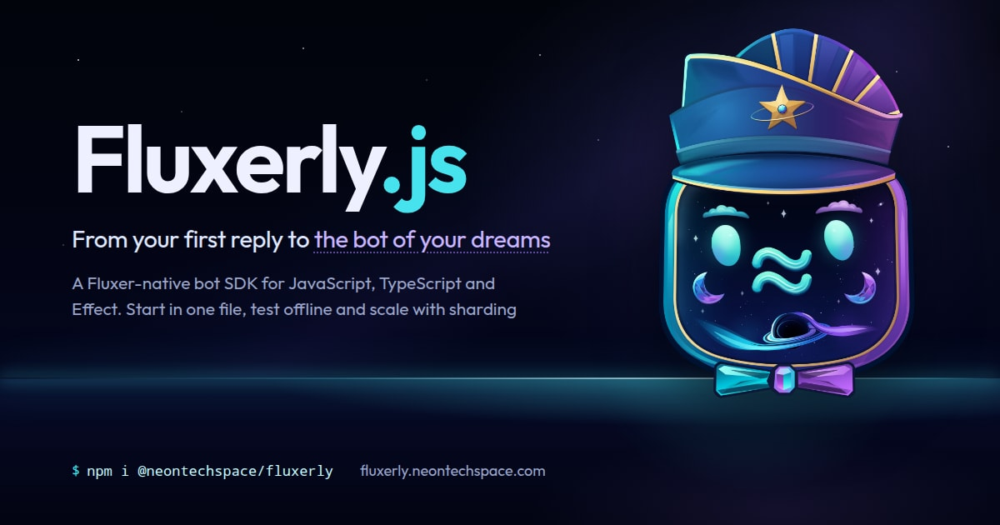
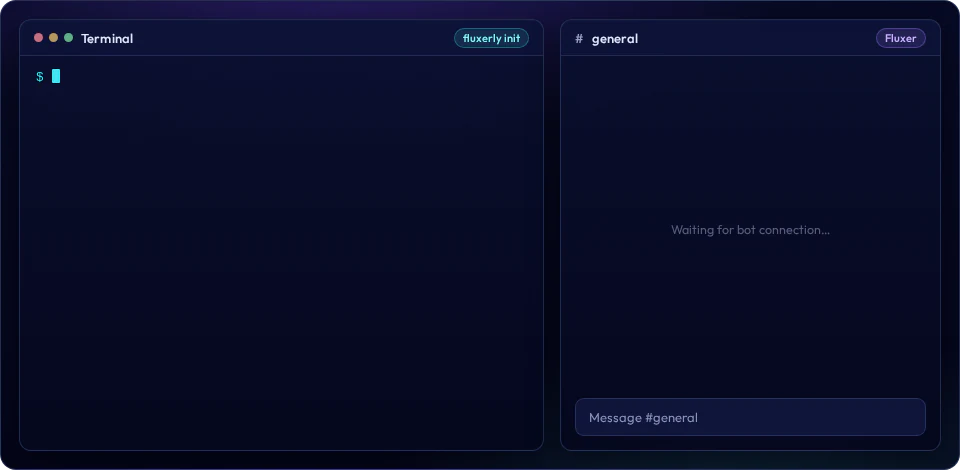
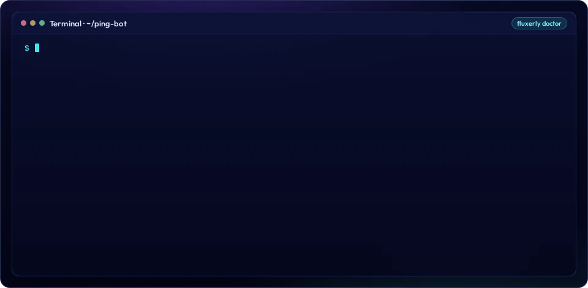
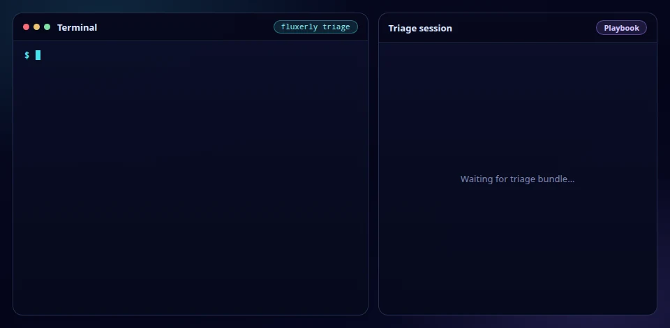

<p align="center">
  <a href="https://fluxerly.neontechspace.com/"></a>
</p>

<h1 align="center">Fluxerly.js</h1>

<h3 align="center">From your first reply to the bot of your dreams</h3>

<p align="center">
  Fluxerly.js (FluxerlyJS) is a Fluxer-native bot SDK for JavaScript, TypeScript and Effect · <a href="https://fluxerly.neontechspace.com/">fluxerly.neontechspace.com</a>
</p>

<p align="center">
  <a href="https://github.com/NeonTechSpace/Fluxerly.js/issues"><picture><source media="(prefers-color-scheme: dark)" srcset="https://shieldcn.dev/github/issues/NeonTechSpace/Fluxerly.js.svg?variant=branded&amp;split=true&amp;size=sm&amp;label=Issues&amp;labelColor=111827&amp;color=9333ea&amp;logo=github&amp;mode=dark"></picture></a>
  <a href="https://github.com/NeonTechSpace/Fluxerly.js/pulls"><picture><source media="(prefers-color-scheme: dark)" srcset="https://shieldcn.dev/github/prs/NeonTechSpace/Fluxerly.js.svg?variant=branded&amp;split=true&amp;size=sm&amp;label=PRs&amp;labelColor=111827&amp;color=6366f1&amp;logo=github&amp;mode=dark"></picture></a>
  <a href="https://github.com/NeonTechSpace/Fluxerly.js/forks"><picture><source media="(prefers-color-scheme: dark)" srcset="https://shieldcn.dev/github/forks/NeonTechSpace/Fluxerly.js.svg?variant=branded&amp;split=true&amp;size=sm&amp;label=Forks&amp;labelColor=111827&amp;color=2563eb&amp;logo=github&amp;mode=dark"></picture></a>
  <a href="https://github.com/NeonTechSpace/Fluxerly.js/stargazers"><picture><source media="(prefers-color-scheme: dark)" srcset="https://shieldcn.dev/github/stars/NeonTechSpace/Fluxerly.js.svg?variant=branded&amp;split=true&amp;size=sm&amp;label=Stars&amp;labelColor=111827&amp;color=9a6700&amp;labelTextColor=ffffff&amp;valueColor=ffffff&amp;logo=github&amp;mode=dark"></picture></a>
</p>

<p align="center">
  <a href="https://www.npmjs.com/package/@neontechspace/fluxerly"><picture><source media="(prefers-color-scheme: dark)" srcset="https://shieldcn.dev/npm/v/@neontechspace/fluxerly/latest.svg?variant=branded&amp;split=true&amp;size=sm&amp;label=npm&amp;labelColor=111827&amp;color=5c1028&amp;labelTextColor=ffffff&amp;valueColor=ffffff&amp;logo=npm&amp;mode=dark"></picture></a>
  <a href="https://ossinsight.io/analyze/NeonTechSpace/Fluxerly.js#overview"><picture><source media="(prefers-color-scheme: dark)" srcset="https://shieldcn.dev/badge/OSS%20Insight-Analytics-0891b2.svg?variant=branded&amp;split=true&amp;size=sm&amp;label=OSS%20Insight&amp;labelColor=111827&amp;color=0891b2&amp;logo=github&amp;mode=dark"></picture></a>
  <picture><source media="(prefers-color-scheme: dark)" srcset="https://shieldcn.dev/badge/Community-Invite%20coming%20soon-0891b2.svg?variant=branded&amp;split=true&amp;size=sm&amp;label=Community&amp;labelColor=111827&amp;color=0891b2&amp;logo=fluxer&amp;mode=dark"></picture>
</p>

<p align="center">
  <a href="https://fluxerly.neontechspace.com/">Home</a> ·
  <a href="https://fluxerly.neontechspace.com/playground/">Playground</a> ·
  <a href="https://fluxerly.neontechspace.com/docs/">Docs</a> ·
  <a href="https://fluxerly.neontechspace.com/docs/quick-start/">Quick start</a> ·
  <a href="https://fluxerly.neontechspace.com/docs/api/">API reference</a> ·
  <a href="https://fluxerly.neontechspace.com/docs/changelog/">Changelog</a> ·
  <a href="https://fluxerly.neontechspace.com/docs/examples/">Examples</a> ·
  <a href="https://fluxerly.neontechspace.com/docs/faq/">FAQ</a> ·
  <a href="https://fluxerly.neontechspace.com/SKILL.md">Agent skill</a> ·
  <a href="https://fluxerly.neontechspace.com/llms.txt">llms.txt</a> ·
  <a href="https://github.com/NeonTechSpace/NeonFlux">NeonFlux</a>
</p>

```sh
npm install @neontechspace/fluxerly
```

```js
import { runBot } from "@neontechspace/fluxerly"

await runBot({
    token: process.env.FLUXER_BOT_TOKEN,
    commands: {
        prefix: "!",
        commands: { ping: { execute: ({ reply }) => reply("Pong!") } },
    },
})
```

<p align="center">
  
</p>

Try real `@neontechspace/fluxerly` JavaScript, TypeScript and Effect bots live in the browser [Playground](https://fluxerly.neontechspace.com/playground/) with zero backend setup. The same SDK powers production bots such as [NeonFlux](https://github.com/NeonTechSpace/NeonFlux)

## Built-in CLI: Scaffold, verify and triage

Every `@neontechspace/fluxerly` install ships the `fluxerly` CLI with zero extra global tools. One command scaffolds a tested starter, audits the project offline, launches agent-powered root-cause triage, syncs coding-agent rules or builds an installation link

| Command | What it does | Key flags |
| --- | --- | --- |
| `fluxerly init` | Creates a JavaScript, TypeScript or Effect starter bot with a working `createTestBot` test and `AGENTS.md`, then installs dependencies | `--template js\|ts\|effect`, `--dir <folder>`, `--pm npm\|pnpm\|bun`, `--no-install` |
| `fluxerly doctor` | Verifies runtime, ESM, TypeScript, Effect, installed dependencies, source imports and secret hygiene completely offline | `--json` |
| `fluxerly triage` | Bundles redacted project facts, doctor checks, optional logs or debug traces and the triage playbook for a coding agent | `[problem]`, `--agent claude\|codex\|antigravity`, `--model <id>`, `--dir <folder>`, `--log <file>`, `--run <command>`, `--print` |
| `fluxerly agents` | Writes, refreshes or checks Fluxerly rules for coding agents across `AGENTS.md`, skills and IDE rule files | `--target agents\|skill\|cursor\|claude\|gemini\|all`, `--check`, `--print` |
| `fluxerly invite` | Generates a Fluxer bot installation URL offline from an application ID and permission names or bitfield | `<applicationId>`, `--permissions <value>` |

### Diagnose project setup offline with `fluxerly doctor`

Catch setup and hygiene mistakes before a bot ever connects, with an exact fix printed for every warning or failure

```sh
npx --no fluxerly doctor
```

- **Runtime and modules:** Checks Node.js `>=26.13.0`, ESM `"type": "module"`, `tsconfig.json`, TypeScript 7, `@types/node` and Effect 4 peer alignment
- **Code and agent hygiene:** Flags installed `node_modules` drift, blocked `require()` or deep `/dist/` and `/src/` imports, and outdated `AGENTS.md` rules
- **Secret safety:** Runs completely offline without contacting Fluxer or printing token values, while catching `.gitignore` gaps and extra `Bot` or `Bearer` prefixes in `.env`
- **Works everywhere:** Run with `pnpm exec fluxerly doctor` or `bunx --no-install fluxerly doctor`, and pass `--json` for CI scripts

<p align="center">
  
</p>

### Root-cause bot and SDK issues with `fluxerly triage`

When startup fails, the gateway drops or an API call rejects unexpectedly, bundle redacted project facts and trace the root cause with a coding agent

```sh
npx --no fluxerly triage --run "npm test" "replies fail with 403"
```

- **Automatic context:** Collects SDK and CLI versions, pinned Fluxer server commit, shipped `src/` paths and `doctor` results, plus optional `--log` tails or live `FLUXERLY_DEBUG=rest,gateway` traces from `--run`
- **Three fault layers:** Reads shipped TypeScript source inside `node_modules/@neontechspace/fluxerly/src` and verifies with `createTestBot` to separate bot code, Fluxer permissions and real SDK bugs
- **Any coding agent:** Launches Claude Code, Codex or Antigravity in a terminal, or prints the full redacted brief with `--print` for any agent or chat session
- **Safe by default:** Never reads `.env`, masks tokens and home paths automatically, and asks before editing files or opening an issue

<p align="center">
  
</p>

## What Fluxerly includes

Fluxerly is built for developers at every skill level, from a first bot in one file to large production bots that need full control

| Capability | What ships out of the box |
| --- | --- |
| **One-file start and scaffolding** | Interactive `fluxerly init` starters for JavaScript, TypeScript and Effect with a working test, plus `runBot` lifecycle handling that connects, drains on Ctrl+C and explains failed startups with a fix |
| **Structured, actionable errors** | Network calls return a Result instead of throwing silently, every error carries a stable code, an actionable hint, typo suggestions on unknown options and `describeError` output with `errors.apiCode`, `errors.outcome` and `errors.retryAfterMs`, while logs mask tokens and credentials automatically |
| **Commands, builders and collectors** | Prefix commands with typed arguments, guards, cooldowns, middleware, command groups and generated help, paired with `EmbedBuilder`, `MessageBuilder` and message or reaction collectors |
| **Complete Fluxer coverage** | Messages, embeds, attachments, voice notes, reactions, threads and forum posts, communities, roles and permissions, emoji and stickers, webhooks and OAuth2, with paginated history and opt-in bounded caches |
| **Typed raw escape hatches** | Compile-time checked bot routes via `client.rest.call` using Fluxer's own field names, `client.rest.request` for routes newer than the SDK, and raw gateway events carrying documented payload types |
| **Zero-network testing and playground** | In-memory Fluxer gateway, HTTP server and virtual test clock through `createTestBot` in `/testing` and `/effect/testing`, plus the browser [Playground](https://fluxerly.neontechspace.com/playground/) with fault injection and wire inspection |
| **Two APIs, one engine** | Async/await with Results in `@neontechspace/fluxerly` and native Effect 4 with typed error channels, scopes and layers in `@neontechspace/fluxerly/effect`, backed by one implementation |
| **Production resilience** | Automatic sharding, session resume across restarts, a process supervisor, deadline-aware rate limiting that never blindly replays uncertain writes, and metrics and traces through `observe` |
| **Shipped source and agent workflow** | Full TypeScript `src/` and source maps inside the package, `fluxerly doctor`, `fluxerly triage`, `fluxerly agents`, `fluxerly invite`, plus [SKILL.md](https://fluxerly.neontechspace.com/SKILL.md) and [llms.txt](https://fluxerly.neontechspace.com/llms.txt) |
| **Tracked against Fluxer's server** | Automated drift checks across Fluxer's API documents and server source trees, verified by offline contract tests, live end-to-end Fluxer checks and multi-model security reviews |

The result is less infrastructure to build, with testing, diagnostics and production structure already in place

## Install

Fluxer moves fast, and Fluxerly keeps pace. Two channels fit different bots:

- **Stable:** Releases that passed every check, for bots that value calm
- **Nightly:** The newest changes as they land, for bots that want them first

Fluxerly is tested against Node.js 26.13 or newer. JavaScript needs no compiler, and TypeScript typechecking or compilation requires TypeScript 7 and `@types/node` as a development dependency

| Package manager | Stable | Nightly (exact pin) |
| --- | --- | --- |
| **npm** | `npm install @neontechspace/fluxerly` | `npm install --save-exact @neontechspace/fluxerly@nightly` |
| **pnpm** | `pnpm add @neontechspace/fluxerly` | `pnpm add --save-exact @neontechspace/fluxerly@nightly` |
| **Bun** | `bun add @neontechspace/fluxerly` | `bun add --exact @neontechspace/fluxerly@nightly` |

> A committed lockfile records the exact installed version and keeps installs reproducible. Nightly releases can include breaking changes, so pinning the exact version prevents a fresh install without a lockfile from pulling a newer nightly that breaks the API

## Getting started

A bot needs a Fluxer application, its bot token and an invite to a community. [Create a bot](https://fluxerly.neontechspace.com/docs/create-a-bot/) walks through setup and permissions

```sh
npx @neontechspace/fluxerly init
```

- **Interactive setup:** Pick JavaScript, TypeScript or Effect from the menu (also works with `pnpm dlx` or `bunx`), or follow the [quick start](https://fluxerly.neontechspace.com/docs/quick-start/) by hand
- **Flags for scripts:** Pass `--template js|ts|effect`, `--dir <folder>`, `--pm npm|pnpm|bun` or `--no-install` to skip prompts or installs
- **Safe on existing folders:** Keeps existing `.env` files intact and appends missing `node_modules` and `.env` lines to `.gitignore`

The generated `bot.js` replies **Pong!** to **!ping**:

```js
import { defineBot, runBot } from "@neontechspace/fluxerly"

// The bot's options without its token, so its test can run them through createTestBot without a token or a network
export const bot = defineBot({
    commands: {
        prefix: "!",
        commands: {
            // Returning the reply reports a failed send to the log
            ping: { execute: ({ reply }) => reply("Pong!") },
        },
    },
})

// Running this file starts the bot, while importing it from a test does not.
// A failure that stops the bot, such as a rejected token, is logged and sets a failing exit code
if (import.meta.main) await runBot({ token: process.env.FLUXER_BOT_TOKEN, ...bot })
```

Set `FLUXER_BOT_TOKEN` in `.env`, verify the project with `npm test` and `npx --no fluxerly doctor`, and start the bot with `npm start` (or `npm run dev` to restart on each saved change). Send **!ping** in a channel the bot can read to see **Pong!**

## Choosing an API

Both entry points share one engine with typed events, prefix commands, embeds, attachments, reactions, collectors and optional bounded caches

| API | Import | Testing entry point | Style |
| --- | --- | --- | --- |
| **JavaScript & TypeScript** | `@neontechspace/fluxerly` | `@neontechspace/fluxerly/testing` | Async/await with Results, explicit shutdown and `AbortSignal` cancellation. Zero TypeScript or Effect setup required for JavaScript |
| **Effect 4** | `@neontechspace/fluxerly/effect` | `@neontechspace/fluxerly/effect/testing` | Native `Effect.gen` programs with typed error channels, scopes and structured interruption |

### Why learn Effect?

Bots often grow from one handler into several jobs, listeners and requests that must stop together. Effect describes that work as one program, shares its dependencies and waits for scoped cleanup when it succeeds, fails or is interrupted

For example, a scoped conversation can register a collector, send a question and wait for an answer. If sending fails, the scope releases the collector. Concurrent reads can cancel their unfinished siblings on failure without leaving cleanup to scattered callbacks

Learn the core concepts in the [Effect v4 introduction](https://effect.website/docs/v4/getting-started/why-effect)

<details>
<summary>Installing Effect for a native application</summary>

Applications that import Effect directly must declare it as a direct dependency, using a version within the installed SDK's `peerDependencies.effect` range. Read `node_modules/@neontechspace/fluxerly/package.json`, or the [SDK manifest](/projects/sdk/package.json) for this checkout

Fluxerly is tested against the lowest version in that range and against its Effect 4 development version, which can be newer. Later Effect 4 releases are accepted. Do not install Effect 3 or an Effect 4 prerelease. The versioned documentation gives the matching install command

</details>

## Voice: Waiting for Fluxer's new voice system

> [!NOTE]
> Fluxerly waits for Fluxer's new voice system and does not support voice over LiveKit. Fluxer is replacing LiveKit with its own voice system, which should arrive soon, and bot voice will come with it

Fluxerly does not join voice channels or send live audio or video yet. Until then, voice states, member voice controls such as move, mute, deafen and disconnect, voice notes, and audio or video attachments work

## Repository activity


<p align="center">
  <a href="https://github.com/NeonTechSpace/Fluxerly.js/stargazers">
    <picture>
      <source media="(prefers-color-scheme: dark)" srcset="https://shieldcn.dev/chart/github/stars/NeonTechSpace/Fluxerly.js.svg?theme=violet&amp;mode=dark&amp;width=800&amp;height=240&amp;title=Star%20history&amp;bg=0d1117&amp;yTicks=3&amp;xTicks=3&amp;logo=false">
      
    </picture>
  </a>
</p>

<p align="center">
  <a href="https://www.npmjs.com/package/@neontechspace/fluxerly">
    <picture>
      <source media="(prefers-color-scheme: dark)" srcset="https://shieldcn.dev/chart/npm/@neontechspace/fluxerly.svg?theme=cyan&amp;mode=dark&amp;days=365&amp;width=800&amp;height=240&amp;title=Fluxerly.js%20downloads&amp;bg=0d1117&amp;yTicks=3&amp;xTicks=3&amp;logo=false">
      
    </picture>
  </a>
</p>

Licensed under [Apache-2.0](/LICENSE)
